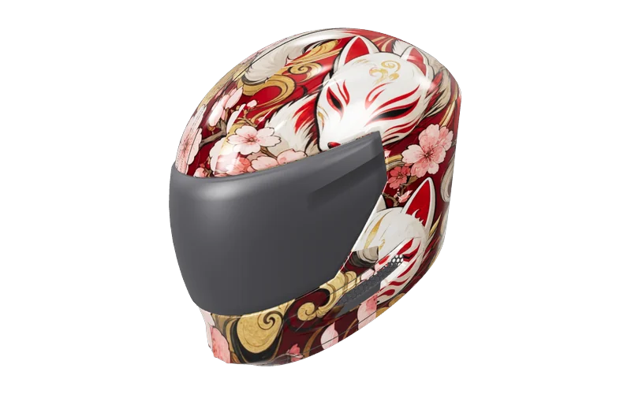
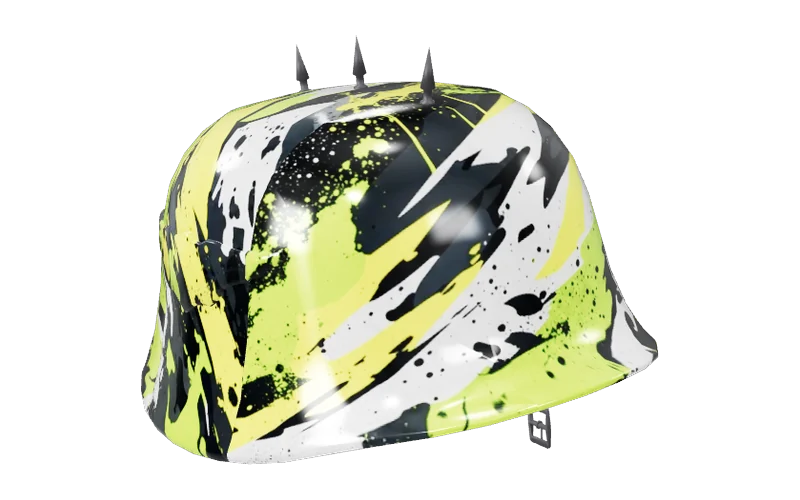

# Motorradhelm Design: 33 Helmschalen und Zonen

[English](README.md) | [Deutsch](README.de.md) | [Français](README.fr.md) | [Italiano](README.it.md) | [Polski](README.pl.md) | [日本語](README.ja.md)

Wie Helmgrafiken und Dekore auf 33 verschiedenen Helmschalen sitzen und welche gestaltbaren Zonen jede Form bietet. Abgedeckt sind 12 Integralhelme, 7 Motocross-Helme, 2 Adventure-Helme, 6 Jethelme und 6 Halbschalenhelme mit fünf Oberflächen: Glanz, Matt, Chrom, Perlmutt und Carbon.

| | | | |
|:---:|:---:|:---:|:---:|
|  Modern Full Face |  Race with Tail Wing |  Street Full Face |  Retro Full Face |
|  Car Racing Style |  Adventure Dual Sport |  Motocross |  Enduro Shell |
|  Retro Open Face |  Jet Long Shield |  Half Helmet |  German Half |

## Dateien

| Datei | Inhalt |
|---|---|
| [STYLES.md](STYLES.md) | Eine Helmschale pro Zeile, mit Kategorie, Kinnbügel, Helmschild und allen gestaltbaren Zonen |
| [styles.json](styles.json) | Dieselben 33 Helmschalen, sechs Zonenschlüssel und fünf Oberflächen als JSON |
| [Interaktiver Katalog](https://dirt-bike-graphics.github.io/custom-motorcycle-helmet/) | Filterbare GitHub-Pages-Tabelle mit direkten 3D-Vorschau-Links für alle 33 Schalen |

## So liest du die Tabelle

Zeile Retro Full Face (`t1_peak`): Geschlossener Kinnbügel und abnehmbarer Sonnenschild bieten alle sechs Schalenzonen (Oberkopf, Stirn, Kinn, Seiten, Hinterkopf und Nacken). Bei Jet- und Halbschalenhelmen fällt der Kinnbügel weg, wodurch die Seitenflächen kürzer ausfallen und klare Streifen oder kompakte Embleme sauberer wirken als hohe Motive.

Nicht abgedeckt: markenspezifische Lüftungsöffnungen, Halterungen für Gegensprechanlagen sowie Größentoleranzen nach DOT, ECE oder Snell. Prüfe vor dem Folieren oder Lackieren immer die Herstellerfreigabe deines Straßenhelms.

## Mitmachen

Frei nutzbar. Fehler gefunden oder fehlt dir eine typische Helmform? Eröffne ein Issue mit Helmtyp, Kategorie und Referenzfotos.

## Verwandtes

- Datenquelle: [Custom Motorcycle Helmet](https://custommotorcyclehelmet.com), ein KI-3D-Designer für Motorradhelme: beschreib dein Wunschdesign oder lade ein Foto hoch, übertrage es auf eine der 33 Helmschalen, ergänze Name und Startnummer und bearbeite alles online
- Live-3D-Designer und Übersichten: [3D-Helm-Designer](https://custommotorcyclehelmet.com/design) | [Integralhelme](https://custommotorcyclehelmet.com/custom-full-face-motorcycle-helmets) | [Motocross-Helme](https://custommotorcyclehelmet.com/custom-dirt-bike-helmets) | [Halbschalenhelme](https://custommotorcyclehelmet.com/custom-half-helmets) | [Helmfolierung](https://custommotorcyclehelmet.com/motorcycle-helmet-wraps) | [Helm-Aufkleber](https://custommotorcyclehelmet.com/motorcycle-helmet-decals)

Idee beschreiben oder mit einem Foto starten, dann Zonen, Aufkleber und Oberflächen in 3D abstimmen. Custom Motorcycle Helmet, die Quelle dieses Helmschalen-Katalogs.

## Anderswo

**Einträge:** [Fazier](https://fazier.com/company/custommotorcyclehelmet) | [VibeCafe](https://vibecafe.ai/products/cmwgt2mt1000008k1u1ds17rg) | [Promote Project](https://www.promoteproject.com/startup/206138/custom-motorcycle-helmet) | [The Hack Stack](https://thehackstack.com/s/custommotorcyclehelmet/) | [Linktree](https://linktr.ee/custommotorcyclehelmet)

**Anleitungen:** [Doku auf GitBook](https://custom-motorcycle-helmet.gitbook.io/custom-motorcycle-helmet/custom-motorcycle-helmet) | [Doku auf Mintlify](https://custom-motorcycle-helmet.mintlify.app/custom-motorcycle-helmet) | [Einen Helm in 3D gestalten](https://customdirtbikegraphics.substack.com/p/how-to-design-a-custom-motorcycle-helmet-in-3d) | [Nahtführung auf gewölbten Schalen](https://dev.to/customdirtbikegraphics/custom-motorcycle-helmet-graphics-in-3d-solving-curved-shell-seam-distortion-and-text-mirroring-238k) | [3D-Anleitung Schritt für Schritt](https://custom-motorcycle-helmet.notion.site/How-to-Design-Your-Own-Custom-Motorcycle-Helmet-in-3D-Step-by-Step-418e389f674480819bfddbe85ed4b928) | [3D-Helm-Design (Folien)](https://slides.com/custommotorcyclehelmet/custom-motorcycle-helmet)

**Demos:** [Hugging Face Space](https://huggingface.co/spaces/customdirtbikegraphics/custom-motorcycle-helmet) | [Interaktiver Schalen-Katalog](https://dirt-bike-graphics.github.io/custom-motorcycle-helmet/)
