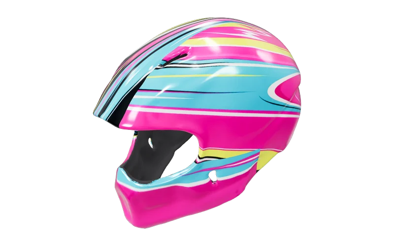
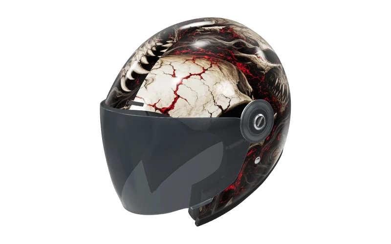
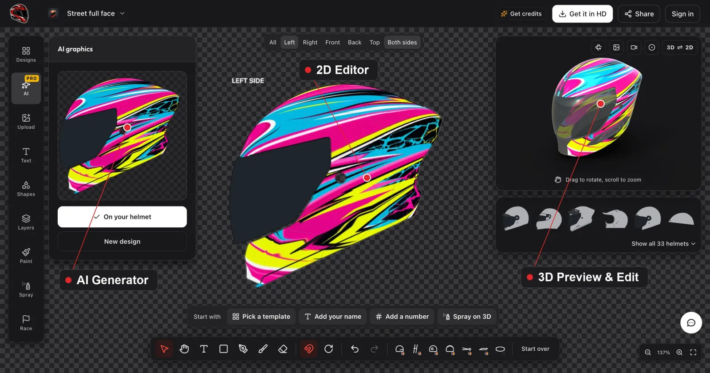

# Casco moto personalizzato: 33 calotte e zone grafiche

[English](README.md) | [Deutsch](README.de.md) | [Français](README.fr.md) | [Italiano](README.it.md) | [Polski](README.pl.md) | [日本語](README.ja.md)

Come si adattano le grafiche su 33 profili di calotta per caschi moto, e quali zone verniciabili mette a disposizione ogni modello. Copre 12 caschi integrali, 7 motocross, 2 adventure dual sport, 6 jet e 6 caschi demi-jet o scodella, con cinque finiture: lucido, opaco, cromato, perlato e fibra di carbonio.

| | | | |
|:---:|:---:|:---:|:---:|
|  Modern Full Face |  Race with Tail Wing |  Street Full Face |  Retro Full Face |
|  Car Racing Style |  Adventure Dual Sport |  Motocross |  Enduro Shell |
|  Retro Open Face |  Jet Long Shield |  Half Helmet |  German Half |

## File

| File | Contenuto |
|---|---|
| [STYLES.md](STYLES.md) | Un profilo di calotta per riga, con categoria, mentoniera, frontino parasole e zone grafiche |
| [styles.json](styles.json) | Gli stessi 33 stili di casco, sei chiavi di zona e cinque finiture in formato JSON |
| [Catalogo interattivo](https://dirt-bike-graphics.github.io/custom-motorcycle-helmet/) | Tabella filtrabile su GitHub Pages con link diretti all'anteprima 3D delle 33 calotte |

## Come leggere la tabella

Riga Retro full face (`t1_peak`): la mentoniera chiusa e il frontino rimovibile offrono tutte le sei zone della calotta (calotta superiore, fronte, mento, fianchi, retro e nuca). Nei caschi jet e a scodella manca la mentoniera, quindi i fianchi sono più bassi e strisce nette o loghi compatti risultano più leggibili rispetto a grafiche sviluppate in altezza.

Non coperto: prese d'aria specifiche dei singoli marchi, ingombro delle staffe interfono e tolleranze di taglia DOT, ECE o Snell. Controlla sempre le indicazioni del produttore del casco prima di verniciare o applicare pellicole wrapping.

## Contribuire

Uso libero. Hai trovato un errore o vuoi segnalare una forma di calotta mancante? Apri una issue indicando stile del casco, categoria e foto di riferimento.

## Collegamenti

- Fonte dei dati: [Custom Motorcycle Helmet](https://custommotorcyclehelmet.com), un configuratore 3D con AI per caschi moto: descrivi la grafica che hai in mente o carica una foto, provala su una delle 33 calotte, aggiungi nome e numero e modificala online
- Editor 3D e guide: [Configuratore 3D](https://custommotorcyclehelmet.com/design) | [Caschi integrali](https://custommotorcyclehelmet.com/custom-full-face-motorcycle-helmets) | [Caschi motocross](https://custommotorcyclehelmet.com/custom-dirt-bike-helmets) | [Caschi scodella](https://custommotorcyclehelmet.com/custom-half-helmets) | [Wrapping casco](https://custommotorcyclehelmet.com/motorcycle-helmet-wraps) | [Adesivi casco](https://custommotorcyclehelmet.com/motorcycle-helmet-decals)

Descrivi la tua idea o parti da una foto, poi rifinisci zone, adesivi e finiture in 3D. Custom Motorcycle Helmet, la fonte di questo catalogo calotte.

## Altrove

**Schede:** [Fazier](https://fazier.com/company/custommotorcyclehelmet) | [VibeCafe](https://vibecafe.ai/products/cmwgt2mt1000008k1u1ds17rg) | [Promote Project](https://www.promoteproject.com/startup/206138/custom-motorcycle-helmet) | [The Hack Stack](https://thehackstack.com/s/custommotorcyclehelmet/) | [Linktree](https://linktr.ee/custommotorcyclehelmet)

**Guide:** [Documentazione su GitBook](https://custom-motorcycle-helmet.gitbook.io/custom-motorcycle-helmet/custom-motorcycle-helmet) | [Documentazione su Mintlify](https://custom-motorcycle-helmet.mintlify.app/custom-motorcycle-helmet) | [Progettare un casco in 3D](https://customdirtbikegraphics.substack.com/p/how-to-design-a-custom-motorcycle-helmet-in-3d) | [Giunzioni su calotte curve](https://dev.to/customdirtbikegraphics/custom-motorcycle-helmet-graphics-in-3d-solving-curved-shell-seam-distortion-and-text-mirroring-238k) | [Guida 3D passo dopo passo](https://custom-motorcycle-helmet.notion.site/How-to-Design-Your-Own-Custom-Motorcycle-Helmet-in-3D-Step-by-Step-418e389f674480819bfddbe85ed4b928) | [Design casco 3D (slide)](https://slides.com/custommotorcyclehelmet/custom-motorcycle-helmet)

**Demo:** [Hugging Face Space](https://huggingface.co/spaces/customdirtbikegraphics/custom-motorcycle-helmet) | [Catalogo interattivo calotte](https://dirt-bike-graphics.github.io/custom-motorcycle-helmet/)
