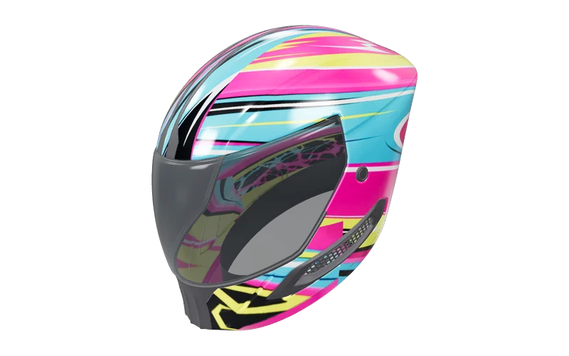
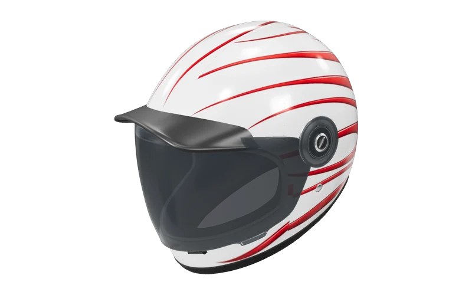
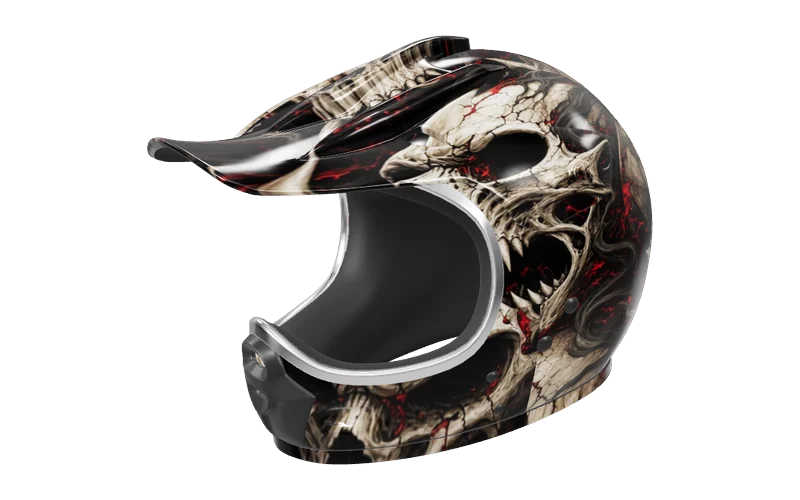
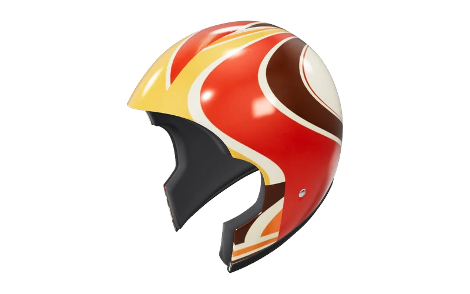

# バイクヘルメット カスタムデザイン: 33種類のシェル形状とゾーン一覧

[English](README.md) | [Deutsch](README.de.md) | [Français](README.fr.md) | [Italiano](README.it.md) | [Polski](README.pl.md) | [日本語](README.ja.md)

33種類のバイク用ヘルメット形状に対してグラフィックやデカールがどう収まるか、それぞれのシェルで塗り分けられるゾーンをまとめたリファレンスです。フルフェイス12種、モトクロス7種、アドベンチャー2種、ジェット6種、ハーフヘルメット6種を収録し、グロス、マット、クローム、パール、カーボンファイバーの5種類の質感に対応しています。

| | | | |
|:---:|:---:|:---:|:---:|
|  Modern Full Face |  Race with Tail Wing |  Street Full Face |  Retro Full Face |
|  Car Racing Style |  Adventure Dual Sport |  Motocross |  Enduro Shell |
|  Retro Open Face |  Jet Long Shield |  Half Helmet |  German Half |

## ファイル

| ファイル | 内容 |
|---|---|
| [STYLES.md](STYLES.md) | 1行に1種類のヘルメット形状を載せ、カテゴリ、チンバー、バイザーピーク、塗装可能なゾーンを整理しています |
| [styles.json](styles.json) | 同じ33種類のシェル、6つのゾーンキー、5種類の表面仕上げを収録したJSONデータです |
| [インタラクティブ一覧](https://dirt-bike-graphics.github.io/custom-motorcycle-helmet/) | カテゴリ別に絞り込めるGitHub Pagesの表で、全33シェルの3Dプレビューへ直接開けます |

## 表の見方

Retro full face (`t1_peak`) の行: チンバーと着脱式ピークを備えているため、6つのゾーンすべて(頭頂部、額、あご、左右サイド、後頭部、首元)にデザインを入れられます。ジェットやハーフヘルメットにはチンバーがなくサイドの高さが短いため、縦に大きい絵柄よりも太めのストライプやコンパクトなロゴの方がすっきり収まります。

対象外: メーカー固有のベンチレーション穴の位置、インカム台座の干渉範囲、およびDOT、ECE、Snell規格ごとの帽体サイズ差は含みません。公道用ヘルメットを塗装またはラッピングする際は、事前にヘルメットメーカーの注意事項を確認してください。

## コントリビュート

自由に使えます。記載ミスや追加したいシェル形状があれば、ヘルメットのタイプ、カテゴリ、参考写真を添えてIssueを立ててください。

## 関連

- データ元: [Custom Motorcycle Helmet](https://custommotorcyclehelmet.com)。AIと3Dでバイクヘルメットをデザインできるオンラインツールです。イメージを文章で伝えるか写真をアップロードすると、33種類のシェルに合わせてAIがデザインを描き、名前やゼッケンを入れてブラウザ上で編集できます
- 3Dデザイナーと各種ガイド: [3Dヘルメットデザイナー](https://custommotorcyclehelmet.com/design) | [フルフェイス](https://custommotorcyclehelmet.com/custom-full-face-motorcycle-helmets) | [オフロード用ヘルメット](https://custommotorcyclehelmet.com/custom-dirt-bike-helmets) | [ハーフヘルメット](https://custommotorcyclehelmet.com/custom-half-helmets) | [ヘルメットラッピング](https://custommotorcyclehelmet.com/motorcycle-helmet-wraps) | [ヘルメットデカール](https://custommotorcyclehelmet.com/motorcycle-helmet-decals)

イメージを伝えるか写真から始めて、ゾーン配色、デカール、表面の質感を3Dで仕上げられます。このシェルデータの出典 Custom Motorcycle Helmet。

## その他の場所

**掲載先:** [Fazier](https://fazier.com/company/custommotorcyclehelmet) | [VibeCafe](https://vibecafe.ai/products/cmwgt2mt1000008k1u1ds17rg) | [Promote Project](https://www.promoteproject.com/startup/206138/custom-motorcycle-helmet) | [The Hack Stack](https://thehackstack.com/s/custommotorcyclehelmet/) | [Linktree](https://linktr.ee/custommotorcyclehelmet)

**ガイド:** [GitBookのドキュメント](https://custom-motorcycle-helmet.gitbook.io/custom-motorcycle-helmet/custom-motorcycle-helmet) | [Mintlifyのドキュメント](https://custom-motorcycle-helmet.mintlify.app/custom-motorcycle-helmet) | [3Dでヘルメットをデザインする手順](https://customdirtbikegraphics.substack.com/p/how-to-design-a-custom-motorcycle-helmet-in-3d) | [曲面シェルの継ぎ目と文字反転の扱い方](https://dev.to/customdirtbikegraphics/custom-motorcycle-helmet-graphics-in-3d-solving-curved-shell-seam-distortion-and-text-mirroring-238k) | [3Dデザイン手順ガイド(Notion)](https://custom-motorcycle-helmet.notion.site/How-to-Design-Your-Own-Custom-Motorcycle-Helmet-in-3D-Step-by-Step-418e389f674480819bfddbe85ed4b928) | [3Dヘルメット設計ガイド(スライド)](https://slides.com/custommotorcyclehelmet/custom-motorcycle-helmet)

**デモ:** [Hugging Face Space](https://huggingface.co/spaces/customdirtbikegraphics/custom-motorcycle-helmet) | [シェル形状インタラクティブ一覧](https://dirt-bike-graphics.github.io/custom-motorcycle-helmet/)
