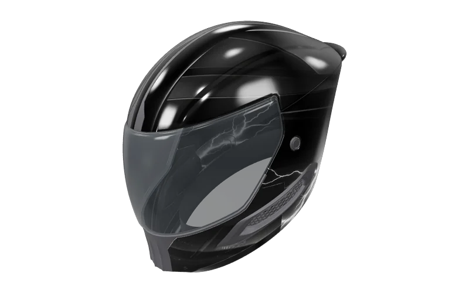
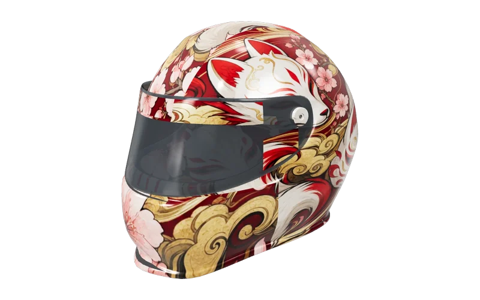
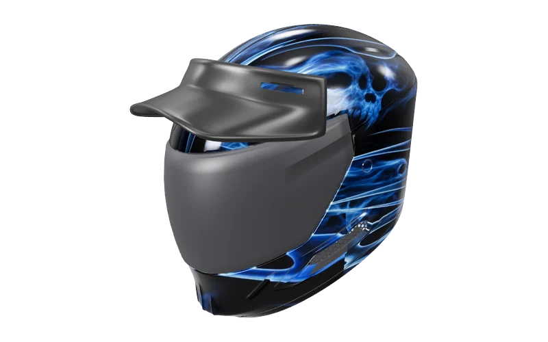

# Custom Motorcycle Helmet

[English](README.md) | [Deutsch](README.de.md) | [Français](README.fr.md) | [Italiano](README.it.md) | [Polski](README.pl.md) | [日本語](README.ja.md)

How motorcycle helmet graphics sit across 33 shell silhouettes, and which paintable zones each style gives you. Covers 12 full face, 7 motocross, 2 adventure, 6 open face and 6 half helmets, with five surface finishes: gloss, matte, chrome, pearl and carbon fiber.

| | | | |
|:---:|:---:|:---:|:---:|
|  Modern Full Face |  Race with Tail Wing |  Street Full Face |  Retro Full Face |
|  Car Racing Style |  Adventure Dual Sport |  Motocross |  Enduro Shell |
|  Retro Open Face |  Jet Long Shield |  Half Helmet |  German Half |

## Files

| File | Contents |
|---|---|
| [STYLES.md](STYLES.md) | One helmet silhouette per row, with its rider category, chin bar, sun peak and paintable zones |
| [styles.json](styles.json) | The same 33 helmet styles, six zone keys and five finish presets as JSON |
| [Interactive catalog](https://dirt-bike-graphics.github.io/custom-motorcycle-helmet/) | Filterable GitHub Pages table with direct 3D preview links for all 33 shells |

## How to read it

Retro full face row (`t1_peak`): a closed chin bar and detachable sun peak give you all six shell zones (crown, forehead, chin, sides, back and neck). Open face and half shells drop the chin bar, leaving shorter side panels where bold stripes or compact badges read cleaner than tall graphics.

Not covered: brand-specific vent cutouts, aftermarket intercom clamp footprints or DOT, ECE and Snell shell sizing tolerances. Check your helmet maker's paint and vinyl guidelines before wrapping or spraying a street shell.

## Contributing

Free to use. Found an error or want to suggest a shell silhouette? Open an issue with the helmet style, rider category and reference photos.

## Related

- Data source: [Custom Motorcycle Helmet](https://custommotorcyclehelmet.com), an AI 3D motorcycle helmet designer: describe the look you want or upload a photo, paint it onto any of the 33 helmet styles, add your name and number, and edit it online
- Live 3D designer and guides: [3D Helmet Designer](https://custommotorcyclehelmet.com/design) | [Full Face Helmets](https://custommotorcyclehelmet.com/custom-full-face-motorcycle-helmets) | [Dirt Bike Helmets](https://custommotorcyclehelmet.com/custom-dirt-bike-helmets) | [Half Helmets](https://custommotorcyclehelmet.com/custom-half-helmets) | [Helmet Wraps](https://custommotorcyclehelmet.com/motorcycle-helmet-wraps) | [Helmet Decals](https://custommotorcyclehelmet.com/motorcycle-helmet-decals)

Describe your idea or start from a photo, then fine-tune zones, decals and finishes in 3D. Custom Motorcycle Helmet, the source of this shell catalog.

## Elsewhere

**Listings:** [Fazier](https://fazier.com/company/custommotorcyclehelmet) | [VibeCafe](https://vibecafe.ai/products/cmwgt2mt1000008k1u1ds17rg) | [Promote Project](https://www.promoteproject.com/startup/206138/custom-motorcycle-helmet) | [The Hack Stack](https://thehackstack.com/s/custommotorcyclehelmet/) | [Linktree](https://linktr.ee/custommotorcyclehelmet)

**Guides:** [Docs on GitBook](https://custom-motorcycle-helmet.gitbook.io/custom-motorcycle-helmet/custom-motorcycle-helmet) | [Docs on Mintlify](https://custom-motorcycle-helmet.mintlify.app/custom-motorcycle-helmet) | [Designing a helmet in 3D](https://customdirtbikegraphics.substack.com/p/how-to-design-a-custom-motorcycle-helmet-in-3d) | [Curved shell seam geometry](https://dev.to/customdirtbikegraphics/custom-motorcycle-helmet-graphics-in-3d-solving-curved-shell-seam-distortion-and-text-mirroring-238k) | [Step-by-step 3D guide](https://custom-motorcycle-helmet.notion.site/How-to-Design-Your-Own-Custom-Motorcycle-Helmet-in-3D-Step-by-Step-418e389f674480819bfddbe85ed4b928) | [3D helmet design (slides)](https://slides.com/custommotorcyclehelmet/custom-motorcycle-helmet)

**Demos:** [Hugging Face Space](https://huggingface.co/spaces/customdirtbikegraphics/custom-motorcycle-helmet) | [Interactive shell catalog](https://dirt-bike-graphics.github.io/custom-motorcycle-helmet/)
