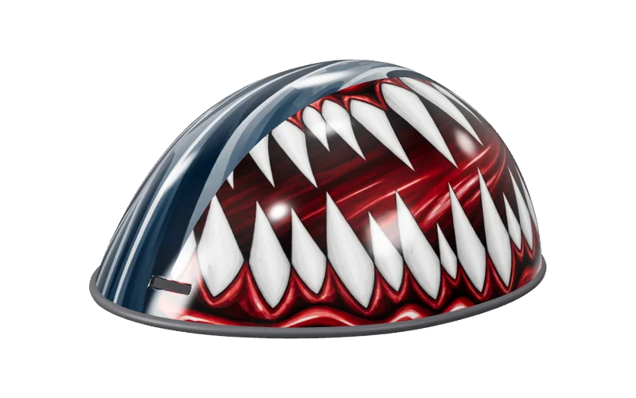

# Własny projekt kasku motocyklowego: 33 skorupy i strefy

[English](README.md) | [Deutsch](README.de.md) | [Français](README.fr.md) | [Italiano](README.it.md) | [Polski](README.pl.md) | [日本語](README.ja.md)

Jak grafiki i okleiny układają się na 33 kształtach skorup kasków motocyklowych oraz jakie strefy malowania daje każdy typ. Zestawienie obejmuje 12 kasków integralnych, 7 crossowych, 2 adventure, 6 otwartych typu jet i 6 krótkich kasków typu orzeszek, z pięcioma wykończeniami: połysk, mat, chrom, perła i włókno węglowe.

| | | | |
|:---:|:---:|:---:|:---:|
|  Modern Full Face |  Race with Tail Wing |  Street Full Face |  Retro Full Face |
|  Car Racing Style |  Adventure Dual Sport |  Motocross |  Enduro Shell |
|  Retro Open Face |  Jet Long Shield |  Half Helmet |  German Half |

## Pliki

| Plik | Zawartość |
|---|---|
| [STYLES.md](STYLES.md) | Jedna sylwetka kasku na wiersz, z kategorią, szczęką, daszkiem i wszystkimi strefami pod grafikę |
| [styles.json](styles.json) | Te same 33 style kasków, sześć kluczy stref i pięć wykończeń w formacie JSON |
| [Katalog interaktywny](https://dirt-bike-graphics.github.io/custom-motorcycle-helmet/) | Filtrowana tabela na GitHub Pages z bezpośrednimi linkami do podglądu 3D wszystkich 33 skorup |

## Jak czytać tabelę

Wiersz Retro full face (`t1_peak`): pełna szczęka i odpinany daszek dają wszystkie sześć stref skorupy (góra, czoło, szczęka, boki, tył i kark). Kaski otwarte i orzeszki nie mają części szczękowej, więc ich boki są niższe i proste pasy albo zwarte emblematy wyglądają na nich czytelniej niż wysokie grafiki.

Czego tu nie ma: wycięć pod wloty powietrza konkretnych marek, uchwytów pod interkomy oraz tolerancji rozmiarowych DOT, ECE i Snell. Przed oklejaniem lub lakierowaniem kasku drogowego sprawdź zalecenia jego producenta.

## Współtworzenie

Możesz korzystać za darmo. Znalazłeś błąd albo brakujący kształt skorupy? Otwórz issue ze stylem kasku, kategorią i zdjęciami referencyjnymi.

## Powiązane

- Źródło danych: [Custom Motorcycle Helmet](https://custommotorcyclehelmet.com), kreator 3D i AI kasków motocyklowych: opisz wymarzony wzór lub wgraj zdjęcie, nałóż go na jedną z 33 skorup, dodaj ksywkę i numer startowy, a potem edytuj projekt online
- Kreator 3D i poradniki: [Kreator 3D kasku](https://custommotorcyclehelmet.com/design) | [Kaski integralne](https://custommotorcyclehelmet.com/custom-full-face-motorcycle-helmets) | [Kaski crossowe](https://custommotorcyclehelmet.com/custom-dirt-bike-helmets) | [Kaski typu orzeszek](https://custommotorcyclehelmet.com/custom-half-helmets) | [Oklejanie kasku](https://custommotorcyclehelmet.com/motorcycle-helmet-wraps) | [Naklejki na kask](https://custommotorcyclehelmet.com/motorcycle-helmet-decals)

Opisujesz pomysł albo zaczynasz od zdjęcia, a potem dopracowujesz strefy, naklejki i wykończenie w 3D. Custom Motorcycle Helmet, źródło tego katalogu skorup.

## Gdzie indziej

**Pakiety:** [npm](https://www.npmjs.com/package/custom-motorcycle-helmet-styles) | [PyPI](https://pypi.org/project/custom-motorcycle-helmet-styles/) | [Crates.io](https://crates.io/crates/custom-motorcycle-helmet-styles) | [Docs.rs](https://docs.rs/custom-motorcycle-helmet-styles) | [Go Packages](https://pkg.go.dev/github.com/dirt-bike-graphics/custom-motorcycle-helmet) | [Packagist](https://packagist.org/packages/custom-graphics/custom-motorcycle-helmet-styles) | [JSR](https://jsr.io/@custom-graphics/custom-motorcycle-helmet-styles) | [Docker Hub](https://hub.docker.com/r/jaxonzhou/custom-motorcycle-helmet-styles) | [VS Code](https://marketplace.visualstudio.com/items?itemName=custom-graphics.custom-motorcycle-helmet-styles) | [Open VSX](https://open-vsx.org/extension/custom-graphics-ref/custom-motorcycle-helmet-styles)

**Katalogi:** [Fazier](https://fazier.com/company/custommotorcyclehelmet) | [VibeCafe](https://vibecafe.ai/products/cmwgt2mt1000008k1u1ds17rg) | [Promote Project](https://www.promoteproject.com/startup/206138/custom-motorcycle-helmet) | [The Hack Stack](https://thehackstack.com/s/custommotorcyclehelmet/) | [PeerPush](https://peerpush.com/p/custom-motorcycle-helmet) | [Linktree](https://linktr.ee/custommotorcyclehelmet)

**Poradniki:** [Dokumentacja na GitBook](https://custom-motorcycle-helmet.gitbook.io/custom-motorcycle-helmet/custom-motorcycle-helmet) | [Dokumentacja na Mintlify](https://custom-motorcycle-helmet.mintlify.app/custom-motorcycle-helmet) | [Projektowanie kasku w 3D](https://customdirtbikegraphics.substack.com/p/how-to-design-a-custom-motorcycle-helmet-in-3d) | [Łączenia grafik na obłej skorupie](https://dev.to/customdirtbikegraphics/custom-motorcycle-helmet-graphics-in-3d-solving-curved-shell-seam-distortion-and-text-mirroring-238k) | [Poradnik 3D krok po kroku](https://custom-motorcycle-helmet.notion.site/How-to-Design-Your-Own-Custom-Motorcycle-Helmet-in-3D-Step-by-Step-418e389f674480819bfddbe85ed4b928) | [Projekt kasku 3D (slajdy)](https://slides.com/custommotorcyclehelmet/custom-motorcycle-helmet)

**Dema:** [Hugging Face Space](https://huggingface.co/spaces/customdirtbikegraphics/custom-motorcycle-helmet) | [Interaktywny katalog skorup](https://dirt-bike-graphics.github.io/custom-motorcycle-helmet/)
